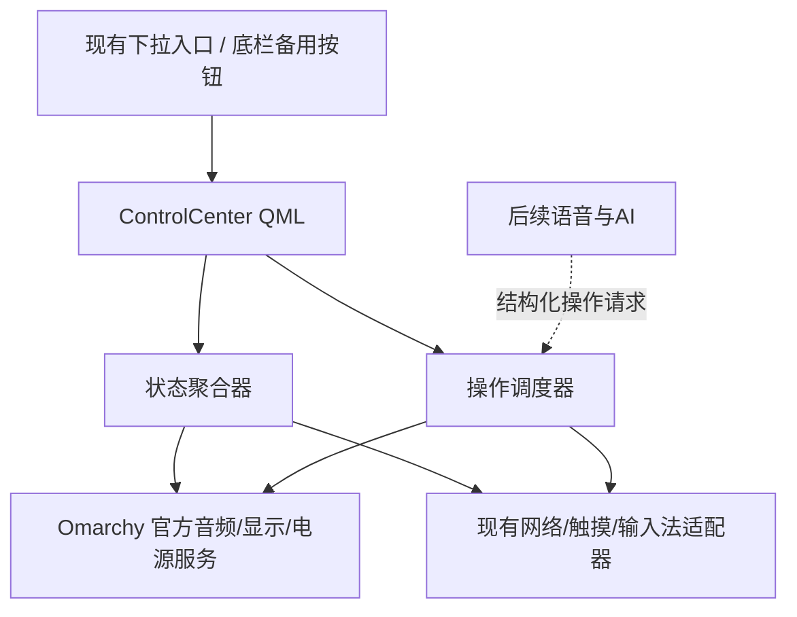

# 启明 · 随身控制台：设计规格

日期：2026-10-16。来源：用户确认的控制中心构思；工作 w-0022。
状态：聊天构思与本文书面规格均已获用户批准；阶段A实施计划已自审、待审阅及选择执行方式。尚未实施或替换现有入口。

## 1. 目标与成功标准

给没有实体键盘、依赖触屏与实体按键的移动平板提供统一控制入口。用户下拉一次知道当前实际网络、代理、电池与设备状况；常用操作最多两次点按完成。正常功能不依赖AI或互联网。网络保持当前用户选择，打开控制台本身不切网、不改电源、不调用云模型。

首版针对当前本机Omarchy版本和已验证硬件。GitHub保留可移植界面与适配器，不把本机配置当作通用安装器；其他设备没有适配器时显示不支持。

## 2. 架构选择与范围

选择：独立Omarchy用户插件承载控制界面，调用已维护工具和官方服务。其余可选方案：继续扩展文字菜单实现便宜但难以提供滑杆及状态总览；独立桌面应用维护较容易隔离，但手势唤起、焦点及多窗口切换负担较大。因此采用原生Quickshell用户插件，不修改打包源文件，不加Hyprland二进制插件。

首版交付紧凑控制台、详细页框架、实际状态与有限操作。语音助理、任务编排、离线内容准备检查是后续独立增量，本次不伪造可用状态。

### 首版功能边界

| 能力 | 首版行为 | 状态来源/操作权威 |
|---|---|---|
| 当前上网出口 | Wi-Fi/4G/有线、自动或手动、检测时间 | 已有network-center适配器 |
| 代理 | TUN是否运行、核心与外网检查分别显示 | 已有代理单实例控制，不读节点 |
| 双电池 | 分别显示电量、充放电状态及有效估算 | 官方电源服务/现有双电池工具 |
| 温度 | 有来源与时间的可读温度；缺失显示未知 | 现有硬件传感器，实施时确认接口 |
| 触摸模式 | 普通/手套，本次切换、硬件读回确认 | 已验TouchMode工具 |
| 输入法 | 打开/收起现有面板；不新增自动弹出 | 现有P1控制接口 |
| 网络详情 | 打开现有六页网络中心 | 保留现有网络控制器 |
| 音量/静音 | 输出音量滑杆、静音；麦克风状态明确 | Omarchy官方音频服务 |
| 亮度 | 滑杆，无法读写时禁用并说明 | Omarchy官方显示服务 |
| 蓝牙 | 状态与原生详情入口 | 官方蓝牙面板 |
| 电源 | 省电/均衡（仅实际支持时）、锁屏 | 官方/Arch已安装电源机制 |
| 熄屏继续工作 | 明确说明作用范围，调用已验DPMS工作流 | 既有后台熄屏工具，不伪称防一切休眠 |
| 飞行模式 | 展示影响并确认，沿用保存/恢复流程 | 已有飞行模式控制器 |
| ZeroTier/GPS | 状态、原有详情与按需操作 | 已有网络中心 |
| 屏幕旋转锁定 | 首版只在确认存在方向控制器时可操作 | 当前未确认，先显示能力待适配 |

## 3. 交互与布局

### 紧凑态

从屏幕顶部展开，宽度不超过当前可用屏幕，居中；横屏默认最大宽760逻辑像素，竖屏随可用宽度收缩。紧凑态最大高度为可用高度的70%，窗口内容与底栏不越界。首屏顺序固定：

1. 标题、收起按钮、最近更新时间。
2. 当前真实网络与TUN状态；双电池和温度摘要。
3. 九个快捷磁贴：Wi-Fi/4G、代理、ZeroTier；触摸模式、输入法、显示方向；飞行模式、电源模式、仅熄屏。
4. 亮度与音量滑杆，以及详情入口。

磁贴最小触控高度64逻辑像素，间隔至少8；标签可换两行，不压缩字体塞满。竖屏必要时改两列并内部滚动，收起与摘要仍可到达。短按完成常用动作；独立详情图标进入详情，不把长按或悬停作为必需入口。不支持的功能禁用并说明，不能伪装成关闭状态。

“Wi-Fi/4G”磁贴打开已有连接详情，不一键关闭当前唯一网络。“代理”可以直接开关，关闭前说明可能影响当前AI连接。手套磁贴明确解释无源笔适用性。

### 详细态

同一面板展开，固定连接、设备、工作、旅途四页；高度固定不随内容跳动，内容区独立滚动。首版连接/设备接入已有工具，工作页提供输入法/截图/窗口操作入口；旅途页只提供现有离线内容入口。任务列表、准备检查和语音入口在实现前保持明确未接入状态，不放失效按钮。

再次下拉的展开行为仅在手势事件路径确认后接入；始终提供可点的“展开/收起”及底栏备用入口。点击外侧关闭；按Esc关闭；打开后不把用户输入发送给后台应用。手势中途取消不执行动作。输入法与控制台不同时争抢前台触摸区域。

### 外观

EVA启发：深灰底、紫色强调、绿色正常、橙色注意、红色失败。状态同时包含文字/形状，不能只靠颜色。短促滑入/展开动画，跟随系统减少动画设置；不持续闪烁，不叠加高成本背景特效，不全局更换字体与图标。

## 4. 输入入口与锁屏

已读源码仅确认顶部12逻辑像素边缘MouseArea识别竖直下滑，动作是quickstatus；没有真实三指计数。用户描述的“三指下滑”是目标使用方式，不能把现有边缘识别当作已验证的三指支持。

实施先确认实际事件路径：保留现有顶部下滑，将成功动作指向新控制台；真实三指识别单独适配、单独验收，不通过全屏透明抓触摸方式阻挡应用书写。无法确认时保留边缘下拉及底栏入口，不宣称三指已完成。

沿用明确未锁定才允许唤起的检查；未知或检查失败时关闭入口。锁屏后关闭面板、释放焦点，禁止执行排队动作。P1/P2/P3及实体旋转键的现有分工保留。

## 5. 组件与接口

权威源码计划位于tools/control-center，便携副本位于工作台modules/control-center。组件职责：

- Panel.qml：固定布局、焦点、展开/收起、状态展示，不执行任意shell。
- ControlModel.js：状态映射、错误与交互状态；不判断硬件成功。
- control_center.py：聚合适配器与白名单操作；不承担新的代理路由实现。
- OmarchyAudio/Display/Power适配器：优先复用已注册服务；精确方法名在实施前从安装源码验证。
- Network适配器：调用现有network-center，不启动第二套检测服务或核心。
- Touch适配器：调用现有TouchMode工具，设置后读取硬件；读状态不反复弹授权。

控制台插件暴露固定IPC：open、close、toggle、expand、state；不暴露通用命令执行。独立插件通过官方bar-widget生命周期加载，底栏备用图标确保入口可发现。手势仅调用toggle，UI故障可以回到原quickstatus菜单。

状态契约字段：capability、available、desired、actual、health、observed_at、stale_after、source、reason。网络单独保留physical_uplink、proxy_core、tun、internet，不能合并成一个“正常”。电池估算缺失显示未知，不能补猜。UI打开首次读取现值，随后订阅事件；关闭时取消界面专用刷新。复用现有网络缓存，不新增高频外网探测。

操作契约：request_id、action、参数白名单、需要确认的影响、当前阶段、结果与读回证据。每个资源同一时间只允许一个修改；重复点按合并/禁用，滑杆拖动结束提交或限速，不每像素触发进程。设置与实测状态分开，成功以读回为准。任何失败不静默切换其他网络。

## 6. 触摸模式与权限

当前开机服务及udev重连规则默认应用手套模式1。控制台“本次模式”只改变当前硬件，不改启动规则；详情明确写“重启/控制器重连后恢复开机默认：手套”。避免用户认为本次切换永久保存。

开机默认切换作为独立后续能力，需要统一修改service/udev的配置来源并验证；首版不添加假开关，也不悄悄禁用现有笔修复。

状态查询不能要求每次打开面板认证。TouchMode状态若需特权，实施复用root工具增加窄范围只读导出，在开机、修改后及控制器重连时刷新；不放宽hidraw设备权限，不给整个Python解释器免密root权限。导出过期时UI显示“待读取”，用户可以显式刷新。修改动作沿用Polkit/P3，密码不进入控制台进程、日志、GitHub或启明。

## 7. 场景与AI的演进边界

后续外出工作、旅途离线、放下继续跑采用“预览影响→执行→逐项验证”协议，记录本次改变及原值，执行中断可恢复。外出检查不等于自动换网；飞行模式不默默结束工作；低电量保护不被场景关闭。

后续AI只提交结构化白名单意图给同一调度器。离线基本控制不依赖模型；收到未知动作明确拒绝。AI诊断只读取本机授权状态，不把个人网络、位置或日志内容默认上传。关网、关机、结束任务与广泛配置修改不因语音误识别直接执行。

## 8. 验证、迁移与回退

先通过纯模型测试覆盖未知/过期状态、操作互斥、权限失败、取消确认、锁屏拒绝；适配器用有代表性的真实返回值与失败样本验证。QML使用本机横屏与竖屏可用几何检查触控尺寸、越界、滚动、焦点和状态更新。运行时逐项核对状态来源，不把文件存在当作可用。

不自动关Wi-Fi、关4G、关代理、切飞行模式、休眠或重启做测试。网络与输入法测试保持用户当前4G会话；必要的断网/重启验证明确列为待验。触摸模式来回切换会影响笔，实际测试前告知并恢复用户原状态。实际手势和手感验收需要用户触摸，软件测试不能替代。

部署前备份菜单扩展、插件manifest、手势调用及涉及的用户配置；新插件先独立验证，失败保留原quickstatus。确认新面板可打开/关闭及锁屏隔离后，再切换下拉动作。回退只恢复新插件及入口引用，不重置shell、不停止ZeroTier、不改现有TUN或磁盘解锁。

## 9. 分阶段交付

A：紧凑态、真实状态、触摸模式、输入法、音量亮度与已有详情入口；保留可回退入口。
B：详细页整合、已适配的电源功能、横竖屏体验和真实手势验收。
C：场景预览/执行、旅途准备检查。
D：低延迟语音入口与AI诊断，沿用同一操作调度器。

本次实施计划只展开A，其他阶段不计入首版完成。登记和代码完成、单测通过、运行时通过、用户触屏验收分别记录。

## 10. 设计自审

已检查：状态真值与意图分离；没有任意root执行接口；手套开机默认与本次切换无冲突；不存在自动断网测试；不把边缘下滑当三指识别；未适配旋转和后续AI明确标记；横竖屏几何、失焦、锁屏、失败与回退均有约束。接口适配仍须在实施计划中核实具体服务方法，未宣称软件或实体交互已经完成。
