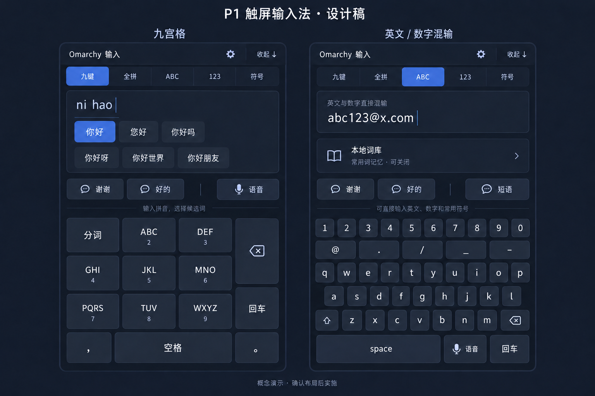

# P1触屏输入法 v0.2 设计 · 待效果图确认

状态：用户授权整理设计并生成演示图；效果图与本规格经用户确认后，再编写实施计划。未改变当前运行输入法。

## 目的与范围

在现有Omarchy原生右侧面板里，让手指打中文、英文/数字/符号混合内容更顺手。沿用Qt/Fcitx/Rime和P1手动呼出，兼容当前全拼、离线语音预览与敏感输入限制。输入法作为Omarchy Tablet Workbench模块；原型源码仍在本机管理项目，迁移另行处理。

首版只优化现有横屏右侧面板；竖屏底部布局、手写、云端AI续写和语音对话机器人不在此轮实现范围。

## 界面布局

1. 顶栏：简短标题、设置入口、固定“收起”。
2. 紧凑模式栏：九键、全拼、ABC、123、符号；选中模式清楚可见。
3. 上中部：明确显示正在组合的拼音和可触摸候选。候选区有最大高度，可滚动/展开；翻页可触屏完成。
4. 中部空白：有拼音时用于候选，有录音/识别结果时用于语音预览；闲置时显示少量常用短语入口和常用符号。没有内容时允许留白，不自动显示私人剪贴板或收集输入框全文。
5. 下部：稳定的主键区与功能键。候选变化不得突然挪动主键区。面板不足高时优先收起辅助内容/滚动候选，不缩小主键到不可点。

## 九宫格

保持三列九格，行顺序为“分词 / ABC 2 / DEF 3”“GHI 4 / JKL 5 / MNO 6”“PQRS 7 / TUV 8 / WXYZ 9”。右侧固定功能列：右上大退格跨前两行，下方回车。底行逗号、宽空格、句号；语音是明确独立按钮。

退格点击删一个；按住450ms后开始连删，初始沿用80ms周期。松手、触摸取消、面板隐藏、焦点丢失或禁用必须停止连删，不触发整段清空。上半区位置固定为常用短语和候选，不能把删除键移到面板顶部而远离手指。

## 全拼与ABC

英文保留三行QWERTY字母并新增常驻数字行1–0；直接输入`abc123@x.com`无需切换数字页。增加一行常用半角符号`@ . / _ -`，完整符号页保留。大小写Shift有清晰状态，删除、空格、回车位置尽量与中文保持一致。全拼沿用Rime组合，不把英文单词预测作为本轮已具备能力。

数字行至少44逻辑像素高，字母键建议不小于48逻辑像素高。实际宽度根据右侧面板实测；若英文十列键过窄，优先讨论适度增宽面板，不静默挤压主应用。演示图是布局意图，不代表固定尺寸验收。

## 本地词库与学习

当前Rime九键enable_completion已开启，九键和全拼均使用luna_pinyin；本机用户词典已存在，但学习效果尚未专项验收。

本轮要显式确认/测试用户词频学习、造词持久化与重启保留；尽量共享九键和全拼的个人词典，先验证兼容性。优先沿用Rime官方机制，增强公共词库须确认来源、许可和效果，保留原词库恢复方式。

设置提供：学习开关、自定义短语、删除误学词、导出/导入用户词库。当前词库内容不写日志，不上传GitHub。密码/敏感输入保持拼音和语音禁用；不把未识别为敏感的所有输入宣称安全。AI下一句预测以后独立设计，不能把普通拼音补全称作AI生成。

## 外观与交互

采用Omarchy主题令牌，深色高对比、柔和边框、统一圆角和间距。主键有轻微按压反馈；重点键用主题强调色，避免整片高亮和常驻闪烁。轻量过渡遵循系统动画策略，不关闭系统动画，也不自行恢复窗口标题栏。

P1开关保持手动；不恢复焦点自动弹出。收起始终可见。语音结果先预览再明确上屏；候选不出现到面板外。

## 验收清单

- T9输入64426能选出“你好”；按预期选择候选，不因新增布局改变拼音映射。
- ABC模式完整输入`abc123@x.com`，Shift/数字/符号位置可触屏使用。
- 删除点击/按住/松手/取消/隐藏均符合预期，末尾不会额外删除。
- 多候选、长拼音、长语音预览和无焦点状态不越界，输入框仍可见。
- 使用隔离测试词验证学习排序、九键/全拼词典关系及重启持久性，不污染正式个人词库。
- 敏感输入、P1开关、语音预览、清空组合、候选分页继续回归。
- 自动验证和真实手指舒适度分别记录，不能相互代替。

## 演示图与下一阶段

生成九键/英文两个面板的并列设计演示，标明概念稿；中文候选和短语只用通用示例。确认图片时一并确认退格位置、数字行、中部用途和视觉方向。确认后按Superpowers编写可执行实施计划，再开发、验证与交付；本文件不是已完成的实施计划。

## 概念图

左右是同一右侧面板的两种模式，不同时显示。图为AI生成的概念稿，字号/尺寸与交互以本规格和真实设备验证为准；英文退格位置可按手感进一步统一。示例输入不是读取用户应用内容的承诺。
