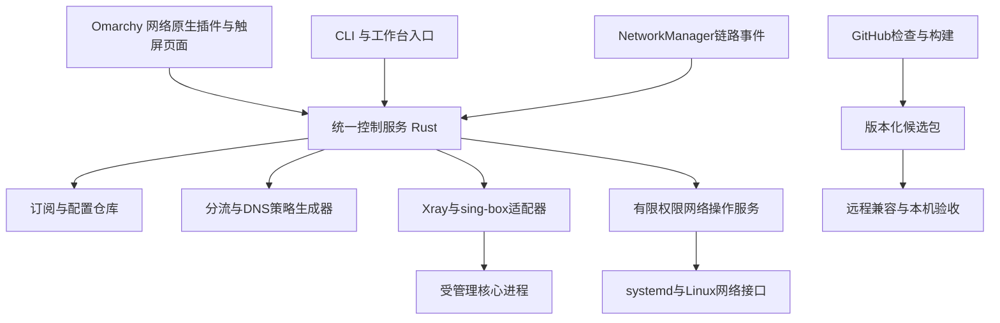

# Omarchy 原生代理管理架构草案

日期：2026-10-17。状态：供用户审阅的设计，未实现、未启用自动更新、未提交 Omarchy 上游。

## 目标与范围

以 v2rayN 的使用能力为参照，为 Omarchy 网络入口提供原生代理管理：Xray、sing-box、节点与订阅、规则分流、系统代理、TUN、诊断、核心与规则更新。界面适配触屏和普通电脑，作为 Tablet Workbench 网络领域的可独立安装模块，准备可供上游审查的通用适配层。

语音中的“X2AY”按 Xray、“Sandbox”按 sing-box 理解；后者与软件隔离沙箱是两个概念。这里也保留隔离测试，但不以隔离沙箱替代 sing-box 功能需求。以功能对照表明确兼容范围，不承诺首版复刻 v2rayN 的所有协议、订阅方言和配置字段。

约束：Omarchy→Arch→厂商/项目官方→社区；系统软件更新沿发行版渠道。平板不承担完整编译；保留现有可用网络直到独立候选通过验收。端口、网卡、UID及ZeroTier网络由探测/配置获得，不硬编码本机身份。

## 路线比较

| 路线 | 收益 | 代价 | 选择 |
|---|---|---|---|
| 原生界面和控制服务，接成熟核心 | 控制触屏体验、生命周期及更新，复用协议实现 | 需维护核心配置适配和兼容矩阵 | 推荐 |
| 直接维护v2rayN分支 | 现成能力多，能快速验证功能参照 | 沿用原UI/运行时及维护负担，原生整合成本仍在 | 参考与故障复现来源 |
| 自写全部代理协议核心 | 控制范围最大 | 协议正确性、兼容、维护与测量工作远超当前目标 | 暂不采用 |

v2rayN上游明确支持Xray与sing-box，当前仓库标明GPL-3.0。引用实现须保留来源和许可，协议支持应对照选定稳定版本，而非只看最新文档。[v2rayN](https://github.com/2dust/v2rayN)

## 模块与职责

1. **界面**：按已安装Omarchy版本的插件生命周期、主题及QML组件适配网络入口；不假定已有通用VPN provider API，缺失接口先提出最小上游扩展。界面只发命令并展示状态，不持有独立启动逻辑。窗口关闭不停止已开启代理，明确点击关闭才停服务。
2. **控制服务**：Rust优先，一个控制归属；持有期望状态、实际状态、操作ID及配置代次。对开关、选节点、规则更新串行协调，重复命令幂等，忽略过时结果。
3. **配置仓库**：保存订阅、节点身份、自定义规则及最后成功配置。私有链接/认证信息留本地凭据存储或权限受限配置，不入公共CI、日志和仓库。
4. **核心适配器**：探测版本与功能，生成配置、执行核心原生校验、启动停止、读取统计和错误。未知字段与不支持的功能明确报错，不静默丢弃。
5. **网络权限服务**：仅执行定义好的TUN、路由、DNS操作；核对调用者及参数，记录本模块拥有的资源，撤销只涉及自身对象。订阅解析、UI和普通日志不以root运行。
6. **更新模块**：把订阅、规则、核心和应用分开管理，只有控制服务能激活一份候选配置。

数据流为：用户配置→能力检查→版本化候选→核心校验→受控启用→实际网络读回→提交成功状态。校验失败停留在旧配置；发生运行故障时恢复最后成功版本并展示原因。界面不会把“命令已提交”当作“网络已连接”。

## Xray与sing-box如何共存

目标是一个代理会话、一个TUN拥有者和一个控制服务，不把“单实例”误解成任何情况下只能有一个操作系统进程。

- **sing-box直接模式**：经协议验证后，由一个sing-box实例承担TUN、DNS、分流和节点出站。
- **Xray模式**：由Xray承担节点协议与分流；若选定版本的原生TUN满足要求则验证直接模式，否则使用受控的sing-box接入前端，转给一个Xray实例。前端仅做必需的捕获/旁路/转发，业务规则只有一处权威。
- **既有兼容链**：当前本机记录为sing-box TUN前端→本地代理端口→Xray，另有v2rayN GUI。迁移时保留其配置语义，逐步让新控制服务接替GUI；不是再次启动一套并行TUN。

具体协议选择在兼容矩阵中标记：已验、支持但未验、不支持、需组合模式。核心切换必须先做能力检查，不能因节点字段相似而假定两核心可以互换。选定版本后才确认API、TUN权限与规则格式。

## 自动分流与DNS

“自动分流”指连接根据规则选择直连、代理或拒绝；不意味着每条连接调用AI，也不等于无条件自动换节点。

两层优先关系：

1. **传输基础规则**：防止核心自身流量进入自身TUN；DNS引导与必要的本地服务路径；ZeroTier外层流量独立旁路。与可编辑业务规则隔离，普通规则订阅不能覆盖。
2. **业务策略顺序**：用户明确规则→启用的拒绝规则→本地/LAN默认直连→所选公共域名/IP分类→明确的兜底策略。全局代理/全局直连是显式选择，保留传输基础规则。

预设“规则分流”提供国内常见站点直连、指定国外服务走代理的起点，但地理分类不是绝对正确，用户可逐项覆盖。DNS解析策略与路由共同生成，测试IPv4、IPv6、DNS引导、加密DNS及FakeIP按需兼容；不能只改出口规则而遗留错误DNS路径。

统一策略模型只承诺可表达的共同语义。Xray与sing-box各自生成目标格式；核心专有选项保留命名空间，无法转换时明确拒绝。Xray规则顺序影响首个匹配结果；sing-box具有本地/远程rule-set机制，格式与版本需独立适配。[Xray路由](https://xtls.github.io/config/routing.html)、[sing-box规则集](https://sing-box.sagernet.org/configuration/rule-set/)

提供“为什么走这条线路”：可用时显示匹配规则、来源和最终出口；只做静态推演时标“预计”，实际核心观测才标“实际”。连接明细按需开启，不常驻记录完整浏览历史。

## 四类更新

| 对象 | 默认策略建议 | 激活要求 |
|---|---|---|
| 节点订阅 | 每日检查及手动刷新，计费网络可暂停 | 本机下载；长度/格式限制；变更预览；保留自建节点和用户覆盖；当前节点被删除时不静默换线路 |
| 分流规则数据 | 每日检查，下载失败使用已缓存版本 | 来源/版本及可用签名校验；无签名时不能把同源hash当来源认证；兼容与语义测试通过后按设定策略生效 |
| Xray/sing-box核心 | 跟踪上游变化，核对发行版可用版本 | 沿Omarchy/Arch更新；受控升级窗口内配套配置校验和网络验收，不绕过包管理覆盖二进制 |
| 本项目应用/插件 | GitHub构建候选、测试、发布 | 通过兼容验收后形成正式包；由系统更新渠道或明确的测试包流程安装 |

规则更新事务：下载到候选区→校验来源/结构/版本→规则差异与固定用例测试→生成完整候选→原生配置检查→受控切换→直连/代理/DNS/旁路检测→提交；失败恢复上一份可用配置。不同核心不保证相同的热重载能力，若需要重启则界面说明可能短暂重连。

同一更新器拥有更新时间表，避免核心内置远程刷新与外部管理器重复更新。按需生成本地规则文件并激活，保留离线缓存；更新通道自身可使用当前已验证的代理路径，不能依赖尚未下载的规则才能启动。重试退避，不在无网/飞行状态反复测速或下载。

## 界面与移动设备体验

总览固定显示：物理出口、互联网状态、代理实际状态、当前节点、分流模式、TUN、ZeroTier及更新提示。物理出口与TUN接口分开显示。

子页为“总览/节点/订阅/分流/DNS与TUN/更新/诊断”；固定外框、内部滚动，横竖屏共用组件和状态语言。常用动作靠近手指，节点测试与批量测速区分，小流量连通性探测优先。

节点自动优选是独立可选项，默认保持手动选择。启用后使用失败阈值、冷却与迟滞，限制测速并发和流量；不因为一次延迟波动就切换，不承诺现有TCP连接无缝迁移。

NetworkManager继续管理有线/Wi-Fi/4G。控制服务响应链路事件并延迟合并短时抖动；保留用户主动关闭意图。飞行模式暂停代理恢复、订阅/规则刷新与探测；退出后按原意图恢复。屏幕熄灭可继续后台联网，不能把熄屏当系统睡眠。

## 技术选择与性能约束

- Qt/QML用于Omarchy原生入口；Rust用于新增控制/策略/订阅管理代码。
- Xray与sing-box保持独立上游核心，第一阶段不改写其协议实现。
- Python/Shell用于现有低频工具与构建；Lua只在官方集成或明确扩展点需要时使用。
- bpftrace/perf按需诊断，Zig/汇编只有实测热点与可维护收益时单独评估。AI不是转发或分流必需组件。
- 优先事件订阅；界面隐藏时降低非必要统计频率，不持续全节点测速。测空闲CPU/内存、规则加载、连接延迟、吞吐和功耗，分别报告，不用一种指标替代另一种。

## GitHub与隔离验证

1. 提交/PR触发静态检查、配置模型测试和核心版本矩阵测试；按模块路径触发，取消被新提交替代的重复任务。
2. 用网络命名空间及veth构造客户端、出口、DNS、直连目标和模拟代理；验证路由、DNS、断链、核心退出、旧规则缓存、失败更新恢复及单TUN。它不能模拟运营商真实无线链路、GUI手感和电池收益。
3. 单独运行当前稳定核心与候选核心，固定版本/下载摘要/可用签名；所有核心配置字段迁移需要有回归例子。
4. GitHub定期发现上游版本并形成更新提案；公共规则源按许可引用或派生，输出可追溯的规则产物。私人订阅永不送入CI。
5. 发布候选生成Arch包、变更说明、校验及构建来源；之后远程Omarchy兼容验证和平板验收。GitHub官方托管运行器承接外部PR，私人构建机不执行未经审查的外部任务。
6. 现有远程工具先复用；云端隔离能力需要单独验证，不假定现有Bubblewrap环境能原样移植到任何CI宿主。
7. CI默认只读权限，发布任务单独授予最小写入权限；第三方Action固定提交版本，外部PR不读取发布凭据。不以高权限事件执行未经审查的PR代码。上游发现默认跟踪稳定版，自动形成候选或PR，不自动合并并安装到设备。

## 项目归属与上游贡献

继续使用一个源码仓库，现有network-center是过渡集成点。概念上分原生UI适配、控制服务、核心适配、规则/订阅、包与CI；不在设计阶段建立空工程目录或多个互相复制的仓库。原本机管理实例只记录本机相关会员及来源，不扩展到独立源码仓库。

官方贡献拆小：通用插件/状态接口适配→安装与入口→可选代理provider。个人节点、地区规则策略和机器专用配置留在用户配置层，不强加为Omarchy默认。上游是否接受独立核心模块、安装入口或插件登记，需要对照当前维护政策，不能把本草案称为官方已接受方案。

许可单独处理：参考v2rayN交互和公开配置语义与复制其代码不同。复制GPL代码遵守GPL；拟提交Omarchy的适配补丁独立实现并确认目标许可兼容，不能把GPL派生代码直接改标成上游许可。本仓库现有许可不因此自动改变。

## 分阶段交付与验收

| 阶段 | 交付 | 放行条件 |
|---|---|---|
| A 基线与对照 | v2rayN能力表、核心版本、现有配置脱敏模型、UI范围 | 私密信息不进仓库；配置转换用例可复现；崩溃另按证据诊断 |
| B 统一控制与核心适配 | 手动节点、开关、系统代理/TUN、状态与恢复 | 一个控制者/一个TUN；退出UI不掉代理；错误与手动关闭意图正确 |
| C 订阅与分流 | 订阅更新、本地覆盖、DNS/规则预设与解释 | 更新不丢个人规则；离线可启动；错误规则/版本拒绝且可恢复 |
| D 自动化交付 | CI矩阵、上游检查、规则候选、Arch包 | 完整测试日志与来源；不会自动改写平板正在用的网络 |
| E 实机迁移与上游 | 接管现有会话、触屏/4G/ZeroTier验收、最小贡献 | 保留可恢复网络；联网/切换/重启分项通过，随后准备上游提交 |

验收先按当前用户实际使用的协议收敛，能力表中其余项明确标“后续”。第一批不加入负载均衡，不依赖AI决策，不承诺所有订阅及核心配置无损互转，也不在本次设计中刷写网络或启动设置。

## 参考

- [v2rayN功能、源码与许可](https://github.com/2dust/v2rayN)
- [Xray路由与规则](https://xtls.github.io/config/routing.html)
- [sing-box规则集与更新](https://sing-box.sagernet.org/configuration/rule-set/)
- [sing-box TUN](https://sing-box.sagernet.org/configuration/inbound/tun/)
- [Omarchy网络集成](https://omarchy.org/manual/networking/)
- [GitHub Actions](https://docs.github.com/en/actions)
